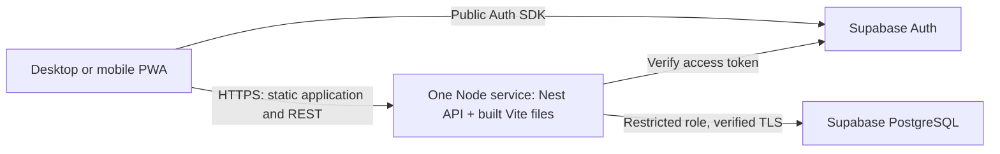

# Pilot delivery plan

## Status and outcome
The user approved execution. Application code for phases 1–7 is now present; acceptance is partial until real-device/browser and hosted end-to-end checks finish. The user applied the initial schema and verified the restricted runtime role with `db:setup`. Docker/Render files are prepared, but phase 8 hosting has not been deployed. See [implementation status](overview.md) for verification evidence and limits. The rest of this note preserves the approved delivery direction rather than claiming every exit criterion passed.

The pilot succeeds when a user can sign in, create an account, import and review the Mercado Pago sample, confirm correct account movements, and view the same saved data on desktop and mobile. A second user cannot access the first user's records.

## Evolution after the pilot
The user requested a broader portfolio/spending/wealth roadmap and confirmed dedicated credit-card and recurring-commitment areas. The [personal finance roadmap](../domains/personal-finance.md) is the source of truth for proposed releases, rules and acceptance. Cards now precede investment/wealth expansion in the proposed delivery order. This preserves the original pilot scope below; roadmap planning does not authorize implementation of every feature.

## Scope
Include authentication, separate user ownership, accounts, categories, manual income/expenses/transfers, Mercado Pago PDF imports, duplicate review, reconciliation, import reversal, a monthly home dashboard, export/restore, responsive navigation, installable PWA, and light/dark/system themes.

Defer credit-card billing/installment accounting, portfolio tracking, full net worth, reserve planning, goals, budgets, recurring transactions, bank connections, and offline writes. The semantic import model accommodates known payment metadata without pretending that these product features are implemented.

## Stack proposal
| Area | Choice and reason |
| --- | --- |
| Workspace | npm workspaces with `app/` and `api/`, one root lockfile and root quality commands |
| Frontend | React, TypeScript strict, Vite, React Router; a private responsive application without an SSR requirement |
| Visual layer | CSS Modules and semantic CSS variables; accessible headless primitives for complex controls, Lucide icons, locally bundled font |
| State | Component state for interactions, feature hooks for workflows, TanStack Query for server state; context only for auth/theme |
| Forms | React Hook Form and schema validation for presentation; backend validation remains authoritative |
| Backend | Nest, TypeScript strict, DTO validation, parameterized SQL through `pg`; follow Tastly's modular organization |
| Identity | Supabase Auth; browser uses its public Auth SDK, business requests use the MyWallet REST API |
| Data | Supabase PostgreSQL, versioned SQL migrations, row-level security and a restricted API database role |
| Contract | Versioned REST `/v1`, Nest OpenAPI, generated frontend transport types; no imports from backend implementations |
| PDF | PDF.js text extraction behind an institution-specific parser/mapper; pin and test the selected package version |
| Verification | Vitest, Nest test tooling with decorator metadata support, PostgreSQL integration tests, Playwright |

Resolve and lock compatible stable versions during scaffolding. Node 24 LTS is the proposed runtime, matching the sibling project's supported runtime; verify package engine compatibility before installation.

## Repository structure
```text
app/
  public/                       manifest, icons, static assets
  src/
    app/                        router, providers, app shell, global tokens
    features/
      auth/                     api, hooks, models, pages, components, tests
      dashboard/
      accounts/
      transactions/
      imports/
      settings/
    shared/
      api/                      REST client and generated transport types
      ui/                       reused visual primitives
      formatting/               locale presentation, not financial rules
    pwa/                        worker registration and update flow
  test/e2e/
api/
  src/
    main.ts
    app.module.ts
    bootstrap.ts
    core/
      auth/                     verified user identity
      config/                   validated environment
      database/                 pool, transaction and user scope
      errors/                   safe errors and serialization
      http/                     headers, upload limits, request IDs
      rest/                     pagination and response contracts
      openapi/                  published API schema
      integration/              only the cross-module ports in actual use
    composition/                bind ports to module providers
    modules/
      health/
      profiles/
      accounts/
      categories/
      ledger/
      imports/
        parsers/mercado-pago/    supported source format extraction
        mappers/mercado-pago/    source → semantic import record
      dashboard/
      data-export/              export/restore orchestration
  test/e2e/
supabase/
  migrations/                   sole schema migration history
  tests/                        ownership/RLS/constraint checks
knowledge/                      architectural memory
```

Inside a backend business module, use `index.ts`, `<name>.module.ts`, `contracts/`, `controllers/`, `dto/`, `services/`, `repositories/`, `mappers/`, and `tests/` only when used. Do not generate empty layers. Frontend features similarly get only the folders they need.

## Adapt Tastly deliberately
| Observed Tastly pattern | MyWallet adaptation |
| --- | --- |
| `core`, business modules, composition root | Preserve these boundaries and explicit dependency injection |
| Public `index.ts` for each module/core area | Enforce external public imports with an automated boundary check |
| Modules communicate through core ports | Introduce narrow ports for actual calls, e.g. ledger import confirmation and account reads; composition is the only cross-module implementation wiring |
| Tenant scoped by `store_id` | User scope comes from verified identity; owned data uses `user_id`, never a client-supplied owner |
| Services and scoped repositories | Explicit financial use cases and parameterized, user-scoped repositories; no generic CRUD/query framework initially |
| Shared database transaction context | Reuse the concept for atomic transfers and import confirmation, including calls across ports |
| Colocated tests, HTTP tests, OpenAPI, quality scripts | Preserve this development workflow |
| Restaurant integrations and operational infrastructure | Do not carry over restaurant rules, billing providers, outbox, role matrices, or delivery workflows |

Reimplement the relevant conventions within MyWallet; do not import sibling source or mutate Tastly. Some Tastly notes describe older application states, so current API code and current README were also inspected. Its broad repository abstractions, global provider wiring, and database connection settings are not copied automatically. Use verified database TLS here.

## Runtime and infrastructure


- Local: Vite development server proxies `/v1` to Nest; choose unused ports, provisionally 5173/8083. Docker Compose can run the API; disposable PostgreSQL or Supabase local is used for database tests. Do not stop sibling services to free ports.
- Pilot hosting proposal: one Docker web service on Render serves Nest and the Vite build on the same HTTPS origin. Supabase hosts PostgreSQL/Auth. The service needs no persistent disk for financial records or original statement files.
- A separate API hosting account is not configured yet. Render Free is an optional evaluation environment and sleeps after 15 minutes without inbound traffic; select an always-on tier if that startup delay is unacceptable. No hosting purchase or deploy is included in this planning step.
- Production routing keeps API routes, health endpoints, and assets separate; SPA fallback handles only application GET routes. Hashed assets can have long immutable cache headers; HTML, worker, and manifest must support updates.
- Use a bounded `pg` connection pool and timeouts. Prefer direct connectivity for a persistent IPv6 runtime or the exact Supabase session-pooler endpoint from Connect for an IPv4-only runtime. Do not invent a region/pooler hostname.
- Enforce database TLS with certificate verification. Use separate admin/migration and restricted runtime credentials; the existing `postgres` connection is administrative and must not become the API runtime identity.
- Keep the current Supabase project as development/pilot initially. Separate staging/production databases or projects before a public rollout; never direct test cleanup or preview deployments at personal production data.
- Build one reproducible Docker image, inject secrets at runtime, and expose liveness plus database readiness checks. Use request IDs, structured error/latency logs, and upload metrics without statement text, account numbers, passwords, or tokens.
- CI: install from lockfile → lint → typecheck → boundaries → meaningful tests → build → OpenAPI drift check. Database integration and HTTP isolation tests use disposable data; browser tests use synthetic accounts and statements.
- Apply reviewed migrations as an explicit release step, not on API startup. Test fresh-schema reconstruction, backup restoration, and application rollback compatibility. Deploy only after checks and target hosting configuration are complete.

## Authentication, ownership, and data access
- Use Supabase sign-up/sign-in, verification, reset-password, and session refresh. Configure callback/reset URLs for local and pilot origins and verify the actual email delivery path.
- Frontend calls Supabase only for authentication. Business data travels through REST with a user access token. Never expose database credentials or administrative keys as `VITE_*` values.
- API verifies signature, issuer, audience, expiry, and subject using the Auth SDK or a maintained JWT library. `getSession` output alone is not proof of identity.
- Business services obtain `user_id` from the verified request scope. Scope applies to individual lookups, lists, aggregates, relationships, imports, exports, and mutation receipts.
- Use a restricted, non-owner, non-`BYPASSRLS` runtime role with minimal grants. Each user operation opens a transaction and sets verified claims with transaction-local settings before querying; RLS checks the verified subject. Rollback/release must not leak identity to another pooled request.
- Do not grant browser Data API roles access to business tables in this API-only architecture. Place business tables in a dedicated `wallet` schema and validate actual grants/exposed schemas. RLS remains useful for the runtime role rather than being assumed effective under `postgres`.
- Use `(user_id, id)` constraints and matching composite foreign keys for owned relationships. A transaction must not reference another user's account/category/import even when an ID is known.
- Clear auth and server-state caches when the user changes or signs out. Configure CSP, security headers, bounded upload limits, and auth/upload throttling appropriate to the single-instance pilot.

## Financial consistency and imports
- Ledger owns financial movements and their write invariants. Accounts owns account metadata and opening positions; dashboard reads composed projections and does not write balances.
- BRL is the first supported currency. Persist amounts as exact integer minor units; validate safe integer bounds at JSON/application boundaries. Display Brazilian formatting without using floating-point values as financial authority.
- A manual transaction references one account. A transfer writes equal opposing movements on two owned accounts atomically, with one transfer group; neither leg is income or expense.
- Opening balance has an explicit date and meaning: immediately before the first included movement. Never add an imported opening balance as a new income or reset an established account silently.
- Imported reserve movements can have only an observed account leg. Keep them as unresolved/internal transfers for review, retain their balance effect, and exclude them from income/expense. Link a counterpart only with sufficient evidence; do not invent reserve balances.
- An import preview stores normalized draft items, source row references, file fingerprint, mapper version, opening/closing balances, issues, and expiry. The PDF is processed transiently and discarded; neither private PDFs nor extracted private text become repository fixtures.
- Proposed limits: 10 MB, 100 pages, one active extraction per user, and a bounded execution deadline. Validate these limits against representative files. Extract in a worker thread with timeout/cancellation to avoid blocking the HTTP event loop; no separate queue infrastructure initially.
- Reconcile the whole source statement before deduplication. Compare already recorded entries when importing an overlapping period; do not compare only the newly selected subset against the original full-statement totals.
- Confirmation references a persisted reviewed preview/version. In one transaction, lock the batch/account as needed, revalidate ownership/duplicates, write through the ledger port, and persist an idempotent confirmation receipt. Repeating the same confirmed request returns the existing receipt, including after a lost response.
- Source operation IDs are not unique keys. File fingerprints prevent accidental identical reuploads; overlapping files need row-level candidates and user decisions. Concurrent confirmation must not race duplicate detection.
- Reversal targets only the batch's owned financial entries. If later edits, transfer links, or other dependencies make safe reversal ambiguous, show a conflict and require resolution rather than delete unrelated data.
- Drafts expire after a proposed 24 hours; enforce expiry at access/confirmation and provide an operational cleanup command. Persist committed import provenance without retaining the raw document.

## PWA, offline, and backups
- Manifest, standalone display, correct icon variants, theme color, install guidance where supported, and an update notification that preserves active forms/import review.
- Cache only application shell/static assets in the service worker. Auth endpoints, REST, PDFs, exports, and private responses are network-only and use appropriate no-store headers. Do not persist query-cache contents to browser storage in this pilot.
- Offline opens a clear connectivity screen after the shell loads. Disable financial writes and distinguish unsent changes from confirmed saves. No offline synchronization queue or success messages for unsaved writes.
- Provide versioned JSON export and CSV transaction export. A JSON restore is a reviewed, atomic, idempotent workflow that assigns ownership from the current identity, validates references, and preserves financial amounts; never import source user IDs as authority. CSV is for analysis, not a full backup.
- Verify restoration using synthetic data before accepting real personal records. Provider backups depend on the selected plan; do not assume the free tier supplies the required restore guarantees.

## Execution sequence and acceptance
| Phase | Deliverable | Exit evidence |
| --- | --- | --- |
| 1. Foundation | Workspaces, lint/types/format, API bootstrap, environment validation, OpenAPI, CI and boundary checks | Clean install and build; API liveness; no secret in frontend build |
| 2. Visual shell | Tokens, theme switcher, responsive navigation, authentic empty/error/loading states and reusable controls | Both themes work without a first-paint flash; keyboard/mobile review passes; synthetic fixtures stay in tests/dev |
| 3. Identity and storage | Auth, runtime role, initial migrations, RLS, accounts/categories and opening positions | Two-user HTTP/database isolation, denied cross-user references, migration rebuild, and verified TLS |
| 4. Manual ledger | Income, expenses, atomic transfers, filters, corrections, conflict handling | Exact arithmetic; rollback of incomplete transfers; optimistic version conflict on stale edits |
| 5. Mercado Pago imports | Parser, mapper, preview, validation, duplicate review, confirmation receipt and reversal | Sample reconciles; repeated IDs preserved; replay and concurrent confirmation cannot duplicate entries; no partial writes |
| 6. Integrated home | Period totals, recorded balances, shortcuts, account drill-down and cache invalidation | Home matches ledger after create/edit/import/reversal and browser reload; no fabricated net-worth coverage |
| 7. Recovery and PWA | JSON/CSV export, reviewed restore, shell caching, install/update/offline states | Round-trip restore; logout/user switch isolation; offline writes blocked; update preserves drafts |
| 8. Hosted pilot | Docker deployment, HTTPS, Auth redirects/email, readiness, backup/restore and operational notes | Real desktop/mobile smoke test, install on available devices, sample import reviewed before commit, full quality checks pass |

Complete one end-to-end workflow before expanding to the next module. Do not begin a later financial feature merely to fill navigation.

## Required regression scenarios
- Two users, identical operation references, overlapping date ranges, repeated files, and invalid foreign-account/category references.
- The supplied 24-page Mercado Pago layout, multiline descriptions, repeated page headings, negative values, reserve movements, yields, and duplicate operation references with different amounts.
- Corrupt/encrypted/image-only PDFs, unknown layouts, oversized uploads, page/deadline limits, and parse failures without financial writes.
- Lost confirmation response, retry, concurrent confirmation, stale review, reversal after later edits, and partial import selection.
- Opening balances/date boundaries, transfers between own accounts, one observed transfer leg, exact totals, pagination/filter consistency, and timezone-safe date display.
- Session expiry, refresh, sign-out, account switch, keyboard forms, long labels, responsive widths, themes, reduced motion, and stale worker updates.
- Backup round-trip, migration rebuild, database failure with honest UI feedback, and no sensitive response in service-worker caches.

## Remaining deployment inputs
The plan is actionable locally. Hosted delivery still needs the chosen hosting account/tier, actual session-pooler details if IPv4 is required, runtime database-role credentials, trusted database CA configuration, Auth callback/email settings, and pilot URL. Obtain these during infrastructure setup without putting secrets in documentation.

## References inspected
- Local Tastly: `api/README.md`, `.ai-reference/architecture.md`, `.ai-reference/module-dependencies.md`, `.ai-reference/read-query-conventions.md`, and representative module/controller/service/repository/database/composition code.
- [Nest modules](https://docs.nestjs.com/modules): provider visibility and module boundaries.
- [Supabase connections](https://supabase.com/docs/guides/database/connecting-to-postgres): runtime connection mode and TLS configuration.
- [Supabase RLS](https://supabase.com/docs/guides/database/postgres/row-level-security), [JWT verification](https://supabase.com/docs/guides/auth/jwts), and [Data API protection](https://supabase.com/docs/guides/api/securing-your-api): identity and data boundaries.
- [Vite deployment](https://vite.dev/guide/static-deploy.html), [PWA caching](https://developer.mozilla.org/en-US/docs/Web/Progressive_web_apps/Guides/Caching), and [Render Free limitations](https://render.com/docs/free): built assets, worker lifecycle, and hosting constraints.
